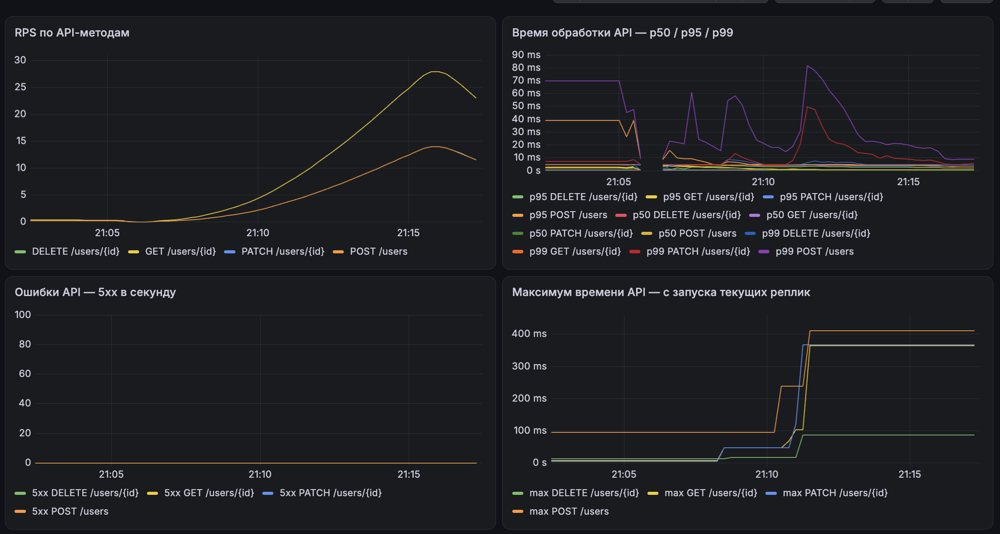
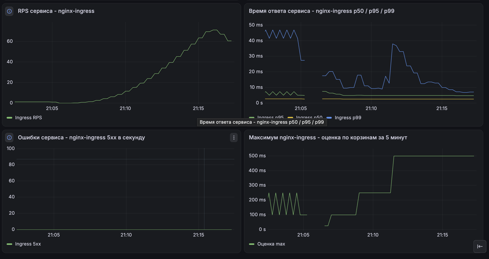

# Health Service — OTUS Microservices

HTTP-сервис на Go: проверка здоровья и CRUD пользователей с хранением в PostgreSQL. Приложение разворачивается в Kubernetes, PostgreSQL устанавливается через Helm, таблица создаётся отдельным Job.

## Как устроено приложение

```text
Клиент → arch.homework:80 → minikube tunnel → nginx Ingress Controller
       → health-app-service:80 → Pod приложения:8000
       → users-db-postgres:5432 → PostgreSQL → PVC
```

Ingress задаёт правила HTTP-маршрутизации. Service направляет запросы к Pod приложения, Deployment поддерживает две реплики. Отдельный Job запускает `psql` для первоначального создания таблицы.

Конфигурация подключения находится в ConfigMap, учётные данные — в Secret. Kubernetes передаёт их в окружение контейнера; Go читает переменные `DB_HOST`, `DB_PORT`, `DB_NAME`, `DB_USER`, `DB_PASSWORD`.

Мониторинг описан в разделе [7. Мониторинг: Prometheus и Grafana](#7-мониторинг-prometheus-и-grafana): приложение и nginx Ingress Controller отдают метрики, Prometheus их собирает, Grafana строит дашборд и проверяет правила алертов.

```text
Pod приложения:8000/metrics ─┐
                             ├─→ Prometheus (namespace monitoring) → Grafana: дашборд и алерты
nginx-ingress :10254/metrics ┘
```

## API

Основной адрес: `http://arch.homework`.

| Метод | Путь | Результат |
| --- | --- | --- |
| GET | `/health/` | `200`, `{"status":"OK"}` |
| POST | `/users` | Создать пользователя, `201` и JSON с ID |
| GET | `/users/{id}` | Получить пользователя, `200` |
| PATCH | `/users/{id}` | Изменить переданные поля, `200` |
| DELETE | `/users/{id}` | Удалить пользователя, `204` без тела |

Поля пользователя: `id`, `name`, `email`. ID назначает БД через `SERIAL`; имя и email обязательны, email уникален. Пробелы по краям имени и email удаляются.

PATCH сохраняет поля, которые не переданы. Пустые строки, `null`, пустой объект и неизвестные поля в PATCH отклоняются с `400`. Некорректный ID также даёт `400`; отсутствующий пользователь — `404`; занятый email — `409` с текстом `учётная запись с данным email уже зарегистрирована`.

## Файлы

| Файл | Назначение |
| --- | --- |
| `main.go` | HTTP-обработчики, валидация, пул соединений и SQL |
| `Dockerfile` | Сборка Go и образ с запуском от непривилегированного пользователя |
| `helm/postgres/values.yaml` | Настройки Helm-чарта PostgreSQL |
| `K8s/ns.yaml` | Namespace `hs` |
| `K8s/app-configmap.yaml` | Адрес, порт и имя БД |
| `K8s/dp.yaml` | Deployment приложения, Secret и пробы |
| `K8s/svc.yaml` | Service приложения, порт 80 → 8000 |
| `K8s/ingress.yaml` | Маршруты `arch.homework` |
| `migrations/001_create_users.sql` | SQL создания таблицы |
| `K8s/migrations-configmap.yaml` | SQL как файл для контейнера миграции |
| `K8s/migrations-job.yaml` | Однократное выполнение SQL через psql |
| `K8s/postman/users-api.postman_collection.json` | Семь запросов и автоматические проверки CRUD |
| `K8s/helm/monitoring/values.yaml` | Настройки kube-prometheus-stack: хранение, интервалы сбора, тома |
| `K8s/helm/nginx/values.yaml` | Включение метрик и ServiceMonitor nginx Ingress Controller |
| `K8s/service-monitor.yaml` | ServiceMonitor: сбор `/metrics` приложения |
| `K8s/grafana/health-service-dashboard.json` | Дашборд Grafana, классический формат для импорта |
| `K8s/grafana/health-service-dashboard-v2.json` | Тот же дашборд в схеме V2 (Grafana 12+) |
| `K8s/grafana/health-service-alert-rules.yaml` | Правила алертов Grafana, формат file provisioning |
| `tests/load/users.js` | Нагрузочный CRUD-сценарий k6 |
| `tests/load/results/crud-load.log` | Лог десятиминутного прогона k6 |
| `docs/screenshots/` | Скриншоты дашборда во время нагрузки |

## Подготовка

Инструкция рассчитана на macOS с Docker Desktop и Minikube с Docker-драйвером. Нужны Docker, Minikube, kubectl и Helm. Для Newman нужны Node.js LTS и npm; для локальной компиляции — Go версии из `go.mod`. При сборке Docker компилятор берётся из образа.

Версии компонентов проверенного окружения: Helm `4.2.4`, чарт PostgreSQL `0.21.2`, образ миграции `postgres:18.6`, образ приложения `artemprotchenko/myapp:metrics-v4`, чарт `kube-prometheus-stack` `92.17.0`, Grafana `13.3.0`, k6 `2.3.0`.

Все команды ниже выполняются из корня репозитория, кроме явно отмеченных действий. Символ `\` переносит одну команду на следующую строку: после него не должно быть пробелов.

```bash
git clone https://github.com/Crank1986/health-service.git
cd health-service
```

Если репозиторий уже скачан, перейдите в его каталог. Запустите Docker Desktop, затем:

```bash
minikube start --driver=docker
kubectl config current-context
kubectl apply -f K8s/ns.yaml
kubectl get storageclass
```

Контекст должен указывать на нужный Minikube. В `values.yaml` указан StorageClass `standard` и том на `1Gi`; такой класс должен существовать.

## 1. Secret для PostgreSQL

Если `postgres-credentials` уже создан для существующей БД, используйте его. Изменение Secret само по себе не меняет пароль роли в уже инициализированной БД.

Для первого запуска создайте приватный файл **вне репозитория**:

```bash
mkdir -p "$HOME/.config/health-service"
chmod 700 "$HOME/.config/health-service"
```

Сохраните туда файл `postgres-credentials.yaml`, заменив оба значения паролей собственными разными паролями:

```yaml
apiVersion: v1
kind: Secret
metadata:
  name: postgres-credentials
  namespace: hs
type: Opaque
stringData:
  postgres-password: "REPLACE_WITH_ADMIN_PASSWORD"
  CUSTOM_USER: "user_app"
  CUSTOM_PASSWORD: "REPLACE_WITH_APP_PASSWORD"
```

```bash
chmod 600 "$HOME/.config/health-service/postgres-credentials.yaml"
kubectl apply -f "$HOME/.config/health-service/postgres-credentials.yaml"
kubectl describe secret postgres-credentials -n hs
```

`describe` показывает имена ключей и размеры, не значения. `postgres-password` нужен администратору, `CUSTOM_PASSWORD` — приложению и миграции. Не добавляйте файл с паролями в Git. Secret отделяет учётные данные от обычных настроек, но сам по себе не гарантирует шифрование данных в хранилище Kubernetes.

## 2. PostgreSQL через Helm

Для первой установки:

```bash
helm install users-db \
  oci://registry-1.docker.io/cloudpirates/postgres \
  --version 0.21.2 \
  --namespace hs \
  --values helm/postgres/values.yaml \
  --wait \
  --timeout 5m

kubectl get pods,svc,pvc -n hs -l app.kubernetes.io/instance=users-db
```

Ожидаются Pod `users-db-postgres-0` в состоянии `Running`, Service `users-db-postgres` на порту `5432` и PVC `data-users-db-postgres-0` в состоянии `Bound`.

Helm создаёт роль `user_app` и БД `users_db` при первоначальной инициализации. Если release уже установлен, не выполняйте `helm install` повторно; проверьте `helm list -n hs` и состояние ресурсов.

## 3. Создание таблицы через Job

```bash
kubectl apply -f K8s/migrations-configmap.yaml
kubectl apply -f K8s/migrations-job.yaml
kubectl wait -n hs --for=condition=complete job/users-migration-001 --timeout=120s
kubectl logs -n hs job/users-migration-001
```

Ожидаемый лог: `CREATE TABLE`. При неудаче изучите `kubectl describe job users-migration-001 -n hs` и логи Job.

ConfigMap превращает SQL в файл `/migrations/001_create_users.sql` внутри контейнера. `psql -f` исполняет этот файл; локальный каталог проекта контейнеру не требуется.

Миграция рассчитана на пустую БД: повторный SQL `CREATE TABLE users` завершится ошибкой, если таблица уже существует. Повторный `apply` завершённого неизменённого Job не запускает его снова. Не удаляйте и не пересоздавайте Job для обычного перезапуска приложения.

SQL хранится и в `migrations/`, и в ConfigMap. Если исходный SQL меняется до первого запуска, обновите ConfigMap:

```bash
kubectl create configmap users-migrations -n hs \
  --from-file=001_create_users.sql=migrations/001_create_users.sql \
  --dry-run=client -o yaml > K8s/migrations-configmap.yaml
```

Эта команда только генерирует YAML. Для изменения уже существующей схемы нужна следующая миграция.

## 4. Приложение

Deployment использует опубликованный образ `artemprotchenko/myapp:metrics-v4`.

```bash
kubectl apply -f K8s/app-configmap.yaml
kubectl apply -f K8s/svc.yaml
kubectl apply -f K8s/dp.yaml
kubectl rollout status deployment/health-service -n hs --timeout=120s
kubectl logs -n hs deployment/health-service --tail=30
```

Ожидаемые сообщения: `Соединение с PostgreSQL проверено` и `Сервер запущен на :8000`. Приложение проверяет соединение с БД при старте; без обязательных переменных окружения оно не запустится.

Для публикации собственного образа замените `YOUR_DOCKERHUB_USER` на свой логин:

```bash
docker build -t YOUR_DOCKERHUB_USER/myapp:metrics-v4 .
docker login
docker push YOUR_DOCKERHUB_USER/myapp:metrics-v4
```

Затем укажите тот же образ в `K8s/dp.yaml` и повторите `apply` и `rollout status`. Для следующих изменений используйте новый тег.

## 5. Ingress и arch.homework

Проверьте наличие Helm-release `nginx` и Service контроллера в namespace `hs`:

```bash
helm list -n hs
kubectl get service nginx-ingress-nginx-controller -n hs
```

Если контроллер отсутствует, установите его:

```bash
helm repo add ingress-nginx https://kubernetes.github.io/ingress-nginx/
helm repo update
helm install nginx ingress-nginx/ingress-nginx \
  --version 4.15.1 \
  --namespace hs \
  --set controller.service.type=LoadBalancer \
  --wait --timeout 5m
```

Конфигурация предназначена для локального Minikube. Если контроллер с классом `nginx` уже работает, повторная установка не требуется.

```bash
kubectl apply -f K8s/ingress.yaml
```

На Mac добавьте в `/etc/hosts` строку, если её ещё нет:

```text
127.0.0.1 arch.homework
```

Файл можно открыть через `sudo nano /etc/hosts`. В nano: `Ctrl+O`, Enter — сохранить; `Ctrl+X` — выйти. Для sudo нужен пароль macOS. Проверьте разрешение имени:

```bash
dscacheutil -q host -a name arch.homework
```

В отдельном терминале запустите и оставьте работать:

```bash
minikube tunnel
```

В другом терминале:

```bash
curl -i --max-time 10 http://arch.homework/health/
curl -i --max-time 10 http://arch.homework/otusapp/artem/health/
```

Оба маршрута должны возвращать `200` и `{"status":"OK"}`. Первый Ingress направляет `/health/` и `/users` без изменения пути. Второй удаляет префикс `/otusapp/artem` перед отправкой запроса приложению.

Для диагностики приложения в обход Ingress настройте перенаправление локального порта:

```bash
kubectl port-forward -n hs service/health-app-service 8080:80
```

Пока команда работает, приложение доступно через `http://localhost:8080`. Для `arch.homework` этот port-forward не нужен.

## 6. Автоматические проверки Postman / Newman

Коллекция: [users-api.postman_collection.json](K8s/postman/users-api.postman_collection.json). Её можно импортировать в Postman и выполнить через Collection Runner. `base_url` должен быть `http://arch.homework`.

Порядок запросов: Health → создание → чтение → PATCH имени → чтение обновления → удаление → проверка отсутствия. Email генерируется заново при каждом прогоне, ID сохраняется из ответа POST. Сценарий создаёт и удаляет собственного пользователя.

Для запуска из терминала нужны Node.js LTS и npm:

```bash
node --version
npm --version
```

При первом запуске `npx` предложит скачать Newman. Глобальная установка не требуется:

```bash
NO_PROXY=arch.homework,localhost,127.0.0.1 \
no_proxy=arch.homework,localhost,127.0.0.1 \
npx newman run K8s/postman/users-api.postman_collection.json \
  --env-var "base_url=http://arch.homework"
```

`NO_PROXY` / `no_proxy` направляют локальные запросы напрямую; значения перед командой действуют только на этот запуск. Эти настройки позволяют исключить прокси как причину `ECONNRESET` при обращении к локальному сервису. `--env-var` задаёт переменную Postman с приоритетом над одноимённой переменной коллекции.

Результат прогона 2 ноября 2026 года: **7 запросов, 18 проверок, 0 ошибок** через `arch.homework`. Последний `404` ожидаем: пользователь удалён. Это функциональный сценарий, а не нагрузочный тест. Проверки пустых полей, null и конфликта email проводились отдельно вручную и пока не включены в эту коллекцию.

## 7. Мониторинг: Prometheus и Grafana

### Метрики приложения

Приложение использует `github.com/prometheus/client_golang` и отдаёт метрики на `GET /metrics` (порт 8000). Middleware оборачивает четыре CRUD-маршрута; `/health/` и `/metrics` в метрики запросов не попадают. В метке `route` записывается шаблон маршрута (`/users/{id}`), а не реальный ID, чтобы не создавать отдельный временной ряд на каждого пользователя.

| Метрика | Тип | Метки | Назначение |
| --- | --- | --- | --- |
| `http_requests_total` | Counter | `method`, `route`, `status` | RPS и число ответов 5xx |
| `http_request_duration_seconds` | Histogram | `method`, `route` | Квантили p50 / p95 / p99. Корзины: 1, 5, 10, 25, 50, 100, 250, 500 мс, 1, 2.5, 5, 10 с |
| `http_request_duration_max_seconds` | Gauge | `method`, `route` | Точный максимум длительности с момента запуска реплики |

Длительность измеряется внутри приложения от входа в обработчик до его завершения, включая обращение к БД. Сетевой путь клиента и время в Ingress сюда не входят.

### Установка Prometheus и Grafana

```bash
kubectl create namespace monitoring
helm repo add prometheus-community https://prometheus-community.github.io/helm-charts
helm repo update prometheus-community
helm install monitoring prometheus-community/kube-prometheus-stack \
  --version 92.17.0 \
  --namespace monitoring \
  --values K8s/helm/monitoring/values.yaml \
  --wait --timeout 10m
```

В `values.yaml`: хранение истории 3 дня, сбор каждые 15 секунд, PVC 5Gi для Prometheus и 1Gi для Grafana. Сбор метрик etcd, controller-manager и scheduler отключён: в Minikube они слушают только loopback узла, и цели постоянно были бы в состоянии DOWN. Сами компоненты при этом работают.

Установка заметно нагружает память. Проверенная конфигурация: Docker Desktop 5 GiB, контейнер Minikube 4 GiB и 4 CPU.

### Метрики nginx Ingress Controller

Включите метрики контроллера и ServiceMonitor с меткой `release: monitoring`, по которой Prometheus выбирает мониторы:

```bash
helm upgrade nginx ingress-nginx/ingress-nginx \
  --version 4.15.1 \
  --namespace hs \
  --values K8s/helm/nginx/values.yaml \
  --wait --timeout 5m
```

`upgrade` применяет к релизу значения чарта по умолчанию и значения из файла. Тип Service контроллера `LoadBalancer` — значение чарта по умолчанию, поэтому отдельно его указывать не нужно. Проверка:

```bash
kubectl get service nginx-ingress-nginx-controller-metrics -n hs
kubectl get servicemonitor -n hs
```

Ожидается Service на порту `10254` и ServiceMonitor `nginx-ingress-nginx-controller`. Метрики ingress появляются только для запросов через `arch.homework`; port-forward к приложению обходит Ingress.

### Сбор метрик приложения

Для ServiceMonitor в `K8s/svc.yaml` у Service есть метка `app: health-service` и именованный порт `http`. ServiceMonitor находится в namespace `monitoring`, ищет Service в `hs` по этой метке и опрашивает `/metrics` каждого Pod через порт `http`.

```bash
kubectl apply -f K8s/svc.yaml
kubectl apply -f K8s/service-monitor.yaml
kubectl get servicemonitor health-service -n monitoring
```

Проверка в Prometheus:

```bash
kubectl port-forward -n monitoring service/monitoring-kube-prometheus-prometheus 9090:9090
```

Откройте `http://localhost:9090` и выполните запрос `up{namespace="hs"}`. Для двух реплик приложения и контроллера ingress значение должно быть `1`. `up` показывает только успешность последнего сбора, а не корректность ответов API.

### Доступ к Grafana

```bash
kubectl port-forward -n monitoring service/monitoring-grafana 3000:80
```

Адрес — `http://localhost:3000`, пользователь `admin`. Пароль хранится в Secret, созданном чартом:

```bash
kubectl get secret monitoring-grafana -n monitoring \
  -o jsonpath="{.data.admin-password}" | base64 -d; echo
```

Источник данных Prometheus чарт создаёт автоматически.

### Дашборд

Импорт: **Dashboards → New → Import** → загрузить [health-service-dashboard.json](K8s/grafana/health-service-dashboard.json) → в поле Prometheus выбрать источник данных → **Import**. Файл экспортирован с параметром «Export for sharing externally», поэтому источник данных указывается при импорте. Для Grafana 12+ в схеме V2 есть [health-service-dashboard-v2.json](K8s/grafana/health-service-dashboard-v2.json).

Во всех панелях окно `[5m]`.

| Панель | Источник | Запрос |
| --- | --- | --- |
| RPS по API-методам | приложение | `sum by (method, route) (rate(http_requests_total[5m]))` |
| Время обработки API — p50 / p95 / p99 | приложение | `histogram_quantile(q, sum by (le, method, route) (rate(http_request_duration_seconds_bucket[5m])))` |
| Ошибки API — 5xx в секунду | приложение | `sum by (method, route) (rate(http_requests_total{status=~"5.."}[5m]))`, при отсутствии ошибок — 0 |
| Максимум времени API — с запуска текущих реплик | приложение | `max by (method, route) (http_request_duration_max_seconds)` |
| RPS сервиса — nginx-ingress | ingress | `sum(rate(nginx_ingress_controller_requests[5m]))` |
| Время ответа сервиса — nginx-ingress p50 / p95 / p99 | ingress | `histogram_quantile(q, sum by (le) (rate(nginx_ingress_controller_request_duration_seconds_bucket[5m])))` |
| Ошибки сервиса — nginx-ingress 5xx в секунду | ingress | `sum(rate(nginx_ingress_controller_requests{status=~"5.."}[5m]))`, при отсутствии ошибок — 0 |
| Максимум nginx-ingress — оценка по корзинам за 5 минут | ingress | `histogram_quantile(1, sum by (le) (rate(nginx_ingress_controller_request_duration_seconds_bucket[5m])))` |

В запросах приложения используется фильтр `namespace="hs", service="health-app-service"`, в запросах ingress — `namespace="hs", ingress=~"health-ingress|otusapp-ingress"`; в таблице фильтры сокращены. Квантили гистограммы — это оценка по линейной интерполяции внутри корзины, а не точные длительности отдельных запросов. Ingress учитывает весь трафик через оба Ingress, включая `/health/`; метрики приложения — только CRUD-маршруты.

### Алерты

Правила Grafana-managed находятся в папке **OTUS Health Service**, группа `health-service-alerts`, интервал проверки 30 секунд. Экспорт: [health-service-alert-rules.yaml](K8s/grafana/health-service-alert-rules.yaml).

| Правило | Условие | Выдержка |
| --- | --- | --- |
| Health Service — высокая задержка ingress | p95 ingress за 5 минут > 0.2 с | 1m |
| Health Service — ошибки 5xx на ingress | 5xx ingress за 5 минут > 0.1 в секунду | 1m |

Файл в формате Grafana file provisioning: через кнопку Import в интерфейсе он не загружается. Его можно положить в каталог provisioning Grafana (`/etc/grafana/provisioning/alerting/`) или создать правила вручную в **Alerting → Alert rules** по значениям из таблицы. В файле указан `datasourceUid: prometheus` — UID источника, который создаёт kube-prometheus-stack; в другой установке его может потребоваться заменить.

Точка доставки уведомлений не настроена (`receiver: empty`): состояние правил видно в Grafana, но уведомления не отправляются.

### Нагрузочный тест

Сценарий [users.js](tests/load/users.js) на каждом проходе выполняет полный CRUD-цикл со своей записью: POST → GET → PATCH → GET → DELETE. Запросы идут через `arch.homework`, поэтому нужен работающий `minikube tunnel`. Профиль: 1 мин — 2 VU, затем по 2 мин рост до 5 и 10 VU, 4 мин рост до 20 VU, 1 мин спад до 0. В начале каждого прохода пауза 1 секунда.

```bash
k6 run tests/load/users.js 2>&1 | tee tests/load/results/crud-load.log
```

Результат прогона 8 ноября 2026 года ([crud-load.log](tests/load/results/crud-load.log)):

| Показатель | Значение |
| --- | --- |
| Длительность | 10 мин |
| Завершённые CRUD-циклы | 5 255, прерванных 0 |
| HTTP-запросы | 26 275, в среднем 43.7 RPS |
| Проверки k6 | 78 825 из 78 825 |
| Ошибки HTTP | 0 |
| Время ответа (клиент k6) | среднее 4.34 мс, медиана 1.73 мс, p95 13.54 мс, max 498.37 мс |

При таком профиле сервис работал без ошибок; предел производительности этим тестом не определялся. Ошибок 5xx не было, поэтому графики ошибок во время нагрузки показывают ноль.

### Скриншоты

Дашборд за период нагрузки 8 ноября 2026, 21:05–21:22 MSK:





## Полезные команды и флаги

Подключение к PostgreSQL:

```bash
kubectl exec -it users-db-postgres-0 -n hs -- \
  psql -h users-db-postgres -U user_app -d users_db -W
```

Введите пароль `CUSTOM_PASSWORD`. В psql: `\dt` — таблицы, `\d users` — структура таблицы, `\q` — выход.

| Элемент | Значение |
| --- | --- |
| `kubectl exec` | Выполнить программу в контейнере Pod |
| `-i`, `-t` | Interactive stdin и terminal: ввод с клавиатуры и терминальная сессия |
| `-n` | Namespace: пространство имён |
| `--` | Конец параметров kubectl, далее команда внутри контейнера |
| `psql -h` | Host: адрес PostgreSQL, здесь имя Service |
| `psql -U` | Username: роль БД |
| `psql -d` | Database: имя базы данных |
| `psql -W` | Запросить пароль; не определяет права чтения/записи |
| `psql -w` | Не спрашивать пароль интерактивно; Job использует PGPASSWORD |
| `psql -f` | File: выполнить SQL из файла |
| `psql -v ON_ERROR_STOP=1` | Задать переменную psql: остановиться при SQL-ошибке |
| `kubectl apply -f` | Применить описание ресурсов из файла |
| `helm --values` | Файл настроек чарта |
| `--wait`, `--timeout` | Дождаться результата с ограничением времени |
| `curl -i` | Include: показать заголовки ответа |
| `curl -X` | Задать HTTP-метод |
| `curl -H` | Header: передать заголовок |
| `curl -d` | Data: тело запроса |
| `docker build -t` | Tag: имя и тег собираемого образа |
| `docker build ... .` | Текущий каталог — контекст сборки |

## Диагностика и остановка окружения

| Симптом | Что проверить |
| --- | --- |
| `405 Method Not Allowed` | Метод и путь: POST `/users`, PATCH `/users/{id}` |
| Ошибка положительного ID | В URL подставилось число, а не буквальное `{{user_id}}`; сначала выполнен POST |
| Newman `ECONNRESET`, но curl работает | Запуск с NO_PROXY/no_proxy из раздела выше |
| npm `EACCES` при глобальной установке | Используйте npx, как в инструкции |
| Нет соединения с `arch.homework:80` | Docker Desktop, Minikube, `/etc/hosts`, tunnel и Service контроллера |
| Приложение перезапускается | Логи Pod, Secret, ConfigMap и доступность PostgreSQL |

Для освобождения памяти завершите tunnel и port-forward через `Ctrl+C`, затем:

```bash
minikube stop
```

После этого можно завершить Docker Desktop. Для продолжения снова запустите Docker Desktop, `minikube start` и `minikube tunnel`. Не используйте `minikube delete` или удаление PVC как обычный способ остановки: это может уничтожить данные БД.

## Текущие ограничения

- `/health/` проверяет HTTP-приложение; после запуска доступность БД через этот endpoint не проверяется. Liveness и readiness используют один маршрут.
- Проверки формата email, длины строк и ограничения размера HTTP-тела пока не реализованы. POST и PATCH имеют разную строгость разбора JSON.
- SQL-миграция одна, автоматического учёта версий миграций пока нет.
- `docker-compose.yaml` не содержит PostgreSQL и переменных DB_*. Для текущей версии используйте описанный Kubernetes-сценарий.
- Компоненты проверены в существующем кластере. Полное развёртывание с нуля по этой инструкции отдельно не проверялось.

Мониторинг:

- Точный максимум есть только у приложения, и он считается с момента запуска каждой реплики, а не за последние 5 минут. После перезапуска Pod значение сбрасывается.
- Максимум nginx-ingress — оценка по верхней границе корзины гистограммы. Если запрос попал в корзину `+Inf`, оценка может быть ниже реального максимума.
- Error Rate показан как число ответов 5xx в секунду, а не как процент от всех запросов.
- Механизм срабатывания алертов проверен на правиле задержки с временно сниженным порогом (Pending → Firing). Правило 5xx в состояние Firing не переводилось.
- Уведомления алертов никуда не отправляются: точка доставки не настроена.
- Задание со звёздочкой (CPU и память подов, экспортер PostgreSQL) не выполнялось.
