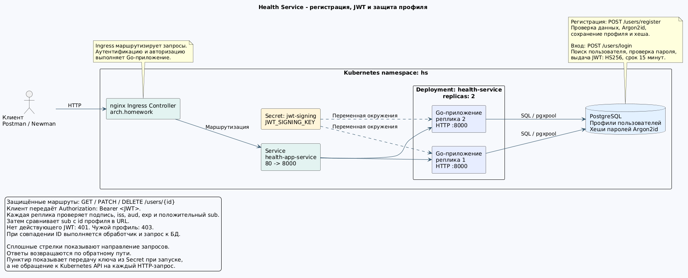

# ДЗ №7 - регистрация, JWT и профиль клиента

Go-приложение регистрирует пользователей, проверяет пароль при входе и выдаёт JWT. Просматривать, изменять и удалять профиль может только пользователь с действующим токеном, чей ID совпадает с ID профиля. При отсутствии входа возвращается 401, при обращении к чужому профилю - 403.

## Архитектура



[Исходник PlantUML](diagrams/health-service-auth.puml). Картинка схемы сохранена в PNG.

Все компоненты приложения устанавливаются в namespace **hs**. Внешние HTTP-запросы к arch.homework принимает существующий nginx Ingress Controller. Ingress направляет запросы через Service health-app-service к одной из двух реплик Deployment health-service. PostgreSQL хранит профили и хеши паролей. Отдельный API Gateway не используется.

Регистрация, вход и профиль реализованы в одном Go-приложении. Создание отдельных микросервисов аутентификации и профиля не требуется выбранному решению. Ingress выполняет маршрутизацию, а приложение - аутентификацию и авторизацию.

### Регистрация и вход

POST /users/register принимает name, email и password. Пароль проверяется по длине 15-128 кодовых точек Unicode. Argon2id использует случайную соль 16 байт, память 19 MiB, два прохода, параллелизм 1, хеш 32 байта. В PostgreSQL сохраняется строка с параметрами, солью и хешем; исходный пароль в профиль и ответ не включается.

POST /users/login ищет пользователя по email и проверяет пароль с сохранённой солью. Неизвестный email, неверный пароль или отсутствие хеша у старой записи дают одинаковое сообщение «Неверный email или пароль» и статус 401. При успехе выдаётся JWT с алгоритмом HS256, полями sub=ID пользователя, iss=health-service, aud=health-service-api, iat и exp через 15 минут. Ответ содержит access_token и token_type=Bearer; Cache-Control: no-store запрещает его кеширование.

### Доступ к профилю

Клиент передаёт `Authorization: Bearer <JWT>`. Приложение проверяет подпись, разрешает только HS256, требует правильные iss/aud, действующий обязательный exp и положительный числовой sub. Затем requireOwnerMiddleware сравнивает sub с id из URL. Только после совпадения вызывается обработчик с доступом к БД.

GET, PATCH и DELETE /users/{id} защищены. Проверка выполняется приложением независимо от того, пришёл запрос напрямую через /users или после удаления префикса /otusapp/artem. Прямой port-forward также не отменяет проверки. metricsMiddleware оборачивает авторизацию и учитывает отклонённые запросы.

Одинаковый ключ JWT_SIGNING_KEY поступает обеим репликам из Secret jwt-signing. При обработке запросов приложение не читает Kubernetes API; ключ загружается из окружения при запуске процесса.

## Файлы

| Файл | Назначение |
| --- | --- |
| [main.go](../main.go) | Регистрация, вход, Argon2id, JWT и проверка владельца |
| [Deployment](../K8s/dp.yaml) | Две реплики auth-owner-v1, конфигурация и Secret |
| [SQL ConfigMap](../K8s/migrations-configmap.yaml) | Миграции 001 и 002 |
| [Job 001](../K8s/migrations-job.yaml) | Создание таблицы users |
| [Job 002](../K8s/migrations-auth-job.yaml) | Добавление password_hash |
| [Коллекция Postman](../K8s/postman/auth-profile.postman_collection.json) | 12 запросов, 43 теста и вывод данных |
| [Результат Newman](test-results/auth-profile-newman.log) | Подтверждённый прогон 23 ноября 2026 |
| [PlantUML](diagrams/health-service-auth.puml) | Редактируемый текст архитектурной схемы |

## 1. Окружение и namespace

Проверенный стенд - macOS, Docker Desktop, Minikube с Docker driver. Нужны kubectl, Helm, Node.js/npm, OpenSSL. Команды выполняются из корня репозитория.

```bash
minikube start --driver=docker
kubectl config current-context
kubectl apply -f K8s/ns.yaml
kubectl get storageclass standard
```

Продолжайте только с выбранным учебным кластером. Namespace приложения, PostgreSQL, JWT Secret и Ingress Controller - **hs**. Для PVC используется StorageClass standard. Полная установка на пустом кластере отдельно не прогонялась; функциональный сценарий проверен в существующем Minikube.

Мониторинг и EFK из предыдущих заданий для №7 не обязательны. На учебном стенде мониторинг был приостановлен ради ресурсов EFK. Рекурсивно применять всю K8s не нужно: там есть независимые компоненты и проверочные миграции.

## 2. PostgreSQL и секреты

### Новый стенд

Создайте Secret postgres-credentials по [разделу 1 README](../README.md#1-secret-для-postgresql), используя собственные пароли вне репозитория. Нужны ключи postgres-password, CUSTOM_USER=user_app и CUSTOM_PASSWORD.

Установите PostgreSQL:

```bash
helm install users-db \
  oci://registry-1.docker.io/cloudpirates/postgres \
  --version 0.21.2 \
  --namespace hs \
  --values helm/postgres/values.yaml \
  --wait --timeout 5m
kubectl get pods,svc,pvc -n hs -l app.kubernetes.io/instance=users-db
```

Ожидаются готовый Pod users-db-postgres-0, Service users-db-postgres и Bound PVC. Существующий release users-db повторно устанавливать не нужно. Изменение Secret не изменяет пароль уже созданной роли PostgreSQL.

### Ключ JWT

Проверьте существование объекта без чтения его значения:

```bash
kubectl get secret jwt-signing -n hs
```

Только если Secret отсутствует, создайте его:

```bash
kubectl create secret generic jwt-signing \
  -n hs \
  --from-literal=JWT_SIGNING_KEY="$(openssl rand -hex 32)"
```

На новом стенде эта команда обязательна до запуска приложения. Генерируются 32 случайных байта, представленные 64 шестнадцатеричными символами. Не заменяйте существующий ключ при обычном обновлении: смена ключа отменит проверку ранее выданных JWT. Изменение значения Secret потребует перезапуска Pod для обновления переменной окружения.

## 3. Миграции

### Пустая БД

Примените обе миграции последовательно:

```bash
kubectl apply -f K8s/migrations-configmap.yaml
kubectl apply -f K8s/migrations-job.yaml
kubectl wait -n hs --for=condition=complete job/users-migration-001 --timeout=120s
kubectl logs -n hs job/users-migration-001
kubectl apply -f K8s/migrations-auth-job.yaml
kubectl wait -n hs --for=condition=complete job/users-migration-002 --timeout=120s
kubectl logs -n hs job/users-migration-002
```

001 создаёт таблицу users. 002 выполняет ALTER TABLE users ADD COLUMN password_hash TEXT. Вторая Job запускается только после успешной первой. Ожидаются migration_completed и соответственно CREATE TABLE / ALTER TABLE. При ошибке остановитесь и проверьте логи, не продолжайте установку приложения.

### Существующая БД

Если таблица есть, а столбца password_hash ещё нет, примените ConfigMap и только Job 002. Если обе миграции уже выполнены, пропустите запуск Job.

Состояние столбца можно проверить без чтения паролей:

```bash
kubectl exec -it users-db-postgres-0 -n hs -- \
  psql -h users-db-postgres -U user_app -d users_db -W
```

Внутри psql:

```sql
SELECT column_name, data_type, is_nullable
FROM information_schema.columns
WHERE table_schema = 'public'
  AND table_name = 'users'
  AND column_name = 'password_hash';
```

Для выхода - `\q`. Наличие столбца означает, что добавлять его повторно не нужно. У старых пользователей допустим NULL-хеш: вход по паролю для них отклоняется.

SQL не идемпотентен, автоматического учёта версий пока нет. Повторный apply неизменённой завершённой Job не запускает SQL заново. Не удаляйте и не пересоздавайте её ради повторения; изменение шаблона существующей Job может быть запрещено как immutable field.

## 4. Установка приложения

Опубликованный образ: artemprotchenko/myapp:auth-owner-v1.

```bash
kubectl apply -f K8s/app-configmap.yaml
kubectl apply -f K8s/svc.yaml
kubectl apply -f K8s/dp.yaml
kubectl rollout status deployment/health-service -n hs --timeout=120s
kubectl get pods -n hs -l env=health-service-env
```

Ожидаются две готовые реплики. Deployment передаёт настройки БД и JWT_SIGNING_KEY через окружение. Без настроек БД либо с JWT-ключом короче 32 байт процесс завершается с ошибкой до запуска HTTP-сервера.

При самостоятельной публикации образа:

```bash
docker build -t YOUR_DOCKERHUB_USER/myapp:auth-owner-v1 .
docker push YOUR_DOCKERHUB_USER/myapp:auth-owner-v1
```

Замените YOUR_DOCKERHUB_USER и образ в Deployment на свой. Для изменений используйте новый тег; один push не обновляет Pod.

## 5. API Gateway, Ingress и доступ

Используется nginx-ingress. Отдельный API Gateway не требуется. Для уже установленного контроллера достаточно проверки release nginx и применения Ingress приложения:

```bash
helm list -n hs
kubectl get service nginx-ingress-nginx-controller -n hs
kubectl apply -f K8s/ingress.yaml
```

Если контроллера ещё нет, перед apply Ingress установите его в hs:

```bash
helm repo add ingress-nginx https://kubernetes.github.io/ingress-nginx/
helm repo update ingress-nginx
helm install nginx ingress-nginx/ingress-nginx \
  --version 4.15.1 \
  --namespace hs \
  --set controller.service.type=LoadBalancer \
  --wait --timeout 5m
kubectl apply -f K8s/ingress.yaml
```

Для базовой установки №7 ServiceMonitor не нужен. Если используется существующий релиз с мониторингом, сохраните его настройки; не переустанавливайте контроллер ради этого сценария.

На Mac проверьте строку `127.0.0.1 arch.homework` в /etc/hosts. В отдельном терминале оставьте работать:

```bash
minikube tunnel
```

В другом терминале проверьте:

```bash
curl --noproxy '*' -i --max-time 10 http://arch.homework/health/
```

Ожидается 200 и JSON status=OK. Доступ через localhost:8080 для диагностики возможен с `kubectl port-forward -n hs service/health-app-service 8080:80`; JWT всё равно проверяется приложением.

## 6. Postman и Newman

Импортируйте [auth-profile.postman_collection.json](../K8s/postman/auth-profile.postman_collection.json) как Collection v2.1. В файле задано baseUrl=http://arch.homework. Все URL используют {{baseUrl}}. Предварительно создавать пользователей или вставлять токены не нужно.

Коллекция последовательно регистрирует первого пользователя, проверяет запреты GET/PATCH без входа, выполняет вход и разрешённое изменение/чтение профиля. Затем регистрирует и аутентифицирует второго пользователя, проверяет запреты GET/PATCH чужого профиля и подтверждает сохранность данных первым пользователем. Logout отсутствует, как допускает условие.

Pre-request регистрации генерирует случайные данные через {{$guid}}. ID и JWT сохраняются переменными коллекции. Повторный полный запуск создаёт новые записи. Коллекция не удаляет пользователей после проверки.

Команда запуска из корня проекта:

```bash
NO_PROXY=arch.homework,localhost,127.0.0.1 \
no_proxy=arch.homework,localhost,127.0.0.1 \
npx --yes newman run K8s/postman/auth-profile.postman_collection.json \
  --timeout-request 10000 \
  --timeout 60000 \
  --reporters cli
```

Общий Post-response выводит метод, URL, тело запроса, статус и тело ответа. Пароль и access_token маскируются как <hidden>. Формат и данные профиля остаются видимыми. Ожидаемые 401/403 считаются успешными отрицательными проверками.

Подтверждённый результат 23 ноября 2026: **12 запросов, 43 теста, 0 ошибок**, 1133 ms. Созданы пользователи 5341 и 5342; ID при повторном запуске будут другими. [Полный вывод Newman](test-results/auth-profile-newman.log) сохранён с маскированными паролями и JWT. 24 test-scripts - общий скрипт коллекции плюс скрипт каждого запроса.

## Границы проверки

Регистрация/вход и запреты доступа подтверждены через arch.homework. Вручную дополнительно проверены неверный пароль, неизвестный email и повреждённый формат JWT. Автоматических отдельных тестов для неверной подписи, истёкшего JWT и неподходящих claims пока нет. DELETE защищён тем же middleware, но в коллекцию №7 не включён.

Старый POST /users оставлен публичным для совместимости и создаёт профиль без пароля. Он не даёт доступ к существующим чужим профилям. Старые коллекция CRUD и нагрузочный сценарий k6 не адаптированы к JWT и не являются текущими тестами №7.

Ограничения учебного решения: локальный HTTP без TLS; нет refresh/logout/отзыва JWT, ограничения попыток входа и выравнивания времени отрицательных ответов; нет ограничения размера HTTP-тела. Часть валидации регистрации строже старого CRUD/PATCH. Миграции без автоматической истории. Полная установка с нуля отдельно не выполнена.
